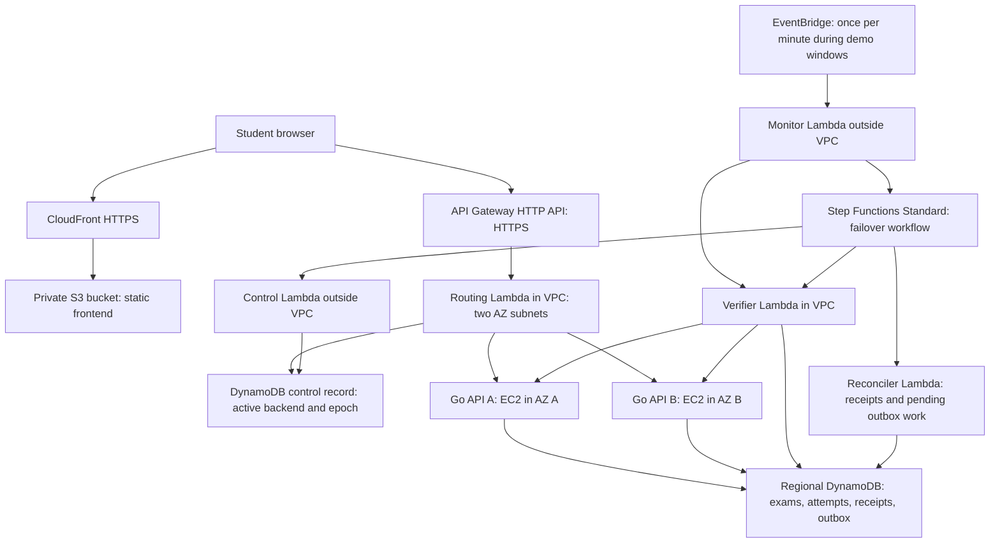

# Continuum: AWS Free Plan implementation and faculty demonstration plan

These are the initial design notes. For the implemented architecture, latest credit observation, measured AWS rehearsal, and current setup commands, use the [runbook](demo-runbook.md), [faculty pitch](faculty-pitch.md), and [review evidence](implementation-review.md). Proposed checks below are design targets, not claims that every item is automated by the deployed verifier.

Prepared for Ayush, 24BIT0394, BCSE355L: Cloud Architecture Design.

Planning date: 10 October 2026. User-reported status: Free plan, USD 100 credits remaining, 149 days remaining. The local AWS configuration and supplied sign-in URL indicate `ap-southeast-2` (Sydney). Confirm the selected Region in AWS Settings → View all projects → Overview → Additional Info → Region before deployment.

## Recommendation

Build an intent-verified **application and instance failover prototype within one AWS Region**, with the primary and standby in separate Availability Zones. Reuse the existing Go exam API, React/TanStack frontend, health-verification code, and Step Functions workflow. Keep both application instances running during AWS tests, then stop or destroy them between sessions.

The assessed deliverable is the exam flow: start an exam, save answers, submit, receive a durable receipt, and recover through a failure. The classroom boards remain available for local development, but their WebSocket recovery is outside this deliverable.

This is a working AWS prototype of application resilience. It does not establish protection against a full Region outage or every possible AZ failure.

Suggested revised title:

> Continuum: An Intent-Verified Automated Failover Framework for Resilient Academic Platforms on AWS

Suggested explanation to faculty:

> The original proposal used cross-region recovery. Our AWS project permits Regional resources only in its selected Region, so the implementation uses separate Availability Zones and a shared regional durable database. We demonstrate application-aware detection, safe promotion, traffic switching, interrupted-request recovery, and reproducible faults. Cross-region disaster recovery remains a future extension.

## Free Plan rules and budget

AWS's current Free plan provides a credit-funded experimentation period. It ends after six months or when credits are exhausted, whichever happens first. While the project remains on that plan, AWS does not charge for usage; upgrading to Paid changes that protection. The USD 200 advertised maximum is not the current balance: this project's confirmed planning balance is USD 100. [AWS Free Tier](https://aws.amazon.com/free/) and [Free Tier FAQs](https://aws.amazon.com/free/free-tier-faqs/).

The new AWS experience restricts Regional resources to the selected Region. Its service list excludes DynamoDB Global Tables, RDS cross-region replicas, S3 cross-region replication, and Route 53 cross-region failover routing. These restrictions are distinct from the six-month credit offer. [Project Regions](https://docs.aws.amazon.com/accounts/latest/reference/project-regions.html) and [supported services and features](https://docs.aws.amazon.com/accounts/latest/reference/supported-services-sign-up-new.html).

Operating rules:

- Keep the project on Free. Do not activate advanced features or switch to Paid to satisfy the original architecture.
- Set an internal total-project spending target of USD 20 in credits. Check gross usage and remaining credits in AWS Settings → Billing; credit offsets can make a net bill look like zero despite consumption.
- Review credits before every AWS rehearsal. Pause new AWS experiments if the balance drops below USD 50, accounting for other work sharing the balance. Preserve at least USD 25 for the final demonstration and reruns.
- Billing alerts are delayed notifications, not a hard spending cutoff. Use bounded tests and explicit lifecycle scripts as operational controls.
- Verify the exact expiry in AWS Settings and schedule the assessment before it. 149 days after the planning date is approximately 8 March 2027; the displayed AWS expiry is authoritative.
- Save a recording, metrics, source, and sample data locally before the Free plan ends. Do not depend on cloud access remaining available afterward.

### Cost model

Public On-Demand rates verified through the AWS Price List API on the planning date:

| Component | Sydney rate | Example usage | Approximate gross usage cost |
| --- | --- | --- | --- |
| Two Linux `t3.micro` instances | USD 0.0132 per instance-hour | Both running for 100 hours | USD 2.64 |
| Two auto-assigned public IPv4 addresses | USD 0.005 per address-hour | Both allocated for 100 hours | USD 1.00 |
| Two 10 GB gp3 disks | USD 0.096 per GB-month | Allocated for the same 100 hours | USD 0.26 |
| API Gateway HTTP API | USD 1.29 per million requests in the first tier | 100,000 small requests | USD 0.13 |

The first three components total approximately USD 3.90 for 100 active hours, using 730 hours per month for storage estimation. These figures exclude DynamoDB requests, Lambda usage, Step Functions, S3, CloudWatch, transfer, and any resources retained between sessions. They are a usage model, not a bill guarantee. Free allowances may reduce eligible usage further. [EC2 pricing](https://aws.amazon.com/ec2/pricing/on-demand/), [EBS pricing](https://aws.amazon.com/ebs/pricing/), [public IPv4 pricing](https://aws.amazon.com/vpc/pricing/), [API Gateway pricing](https://aws.amazon.com/api-gateway/pricing/).

The same compute/IP/disk baseline left allocated and running for 149 days costs approximately USD 139.57. Scheduling AWS sessions is therefore necessary, even with credits.

Aim for roughly 60–100 total active AWS hours over development, rehearsals, and assessment. A USD 10–20 total credit allowance gives room for modest request traffic, logs, retained storage, and mistakes. Validate actual usage after the first short rehearsal before committing the rest of the budget.

Configure burstable instances in **Standard CPU-credit mode** to avoid surplus-credit charges. Build Go binaries and the frontend locally, rather than compiling on 1 GB instances. Use On-Demand instances for predictable demo availability. [T3 behavior](https://aws.amazon.com/ec2/instance-types/t3/).

## Architecture



### Resource choices

| Responsibility | Choice | Reason |
| --- | --- | --- |
| Primary and standby compute | Two `t3.micro` EC2 instances in distinct AZs | Reuse the existing Go server and demonstrate an actual instance stop |
| Public API ingress | API Gateway **HTTP API** | AWS-provided HTTPS endpoint; no purchased domain |
| Verified traffic selection | Small Go routing Lambda | Every request follows the control record; POST traffic switches along with reads |
| Durable data | Regional DynamoDB with on-demand capacity | Reuse the existing store; independent of either application instance; small bounded usage consumes credits |
| Browser frontend | TanStack Start SPA build in private S3, CloudFront with origin access control | Keep Node SSR off the small instances and serve the exam shell through failures |
| Failure verification | Go verifier Lambda | Test actual application behavior and classify failure scope |
| Orchestration | Step Functions **Standard** | Faculty can inspect a visual execution with retries, timeouts, and failure branches |
| Scheduling | EventBridge + small monitor Lambda | Start failover workflows only for confirmed incidents |
| Observability | CloudWatch logs, a few metrics, ops UI timeline | Show the evidence behind each decision |
| Administration | Scoped IAM, Systems Manager, AWS-authenticated control calls | No open SSH or public unauthenticated chaos controls |

Keep one regional table initially if that best matches the existing schema. The control item, exam data, durable idempotency records, and outbox can use distinct key prefixes. A separate small control table is acceptable if it makes IAM and code boundaries clearer. Do not add replicas or indexes without a measured need.

DynamoDB on-demand request usage is not made free merely by the storage allowance. This plan deliberately uses credits for small request traffic. Provisioned capacity is a possible later optimization if the combined tables and indexes fit the project's applicable free allowance and the measured test load; it is not required for the first demo. [DynamoDB pricing](https://aws.amazon.com/dynamodb/pricing/).

Step Functions is the recommended orchestration choice because execution visibility is part of the faculty demonstration. Lambda Durable Functions is a code-first alternative; it would not add useful assessment value here. Standard's advertised free allowance is 4,000 state transitions monthly, but retries and all workflows count toward usage. Do not assume every workflow is free. [Step Functions pricing](https://aws.amazon.com/step-functions/pricing/).

### Networking that avoids an idle NAT Gateway

- Put EC2 A and B in public subnets in distinct AZs. Their auto-assigned public addresses provide outbound access for installation and Systems Manager. Their application ports accept inbound connections only from the router/verifier security group. Port 22 stays closed.
- Attach the routing and verification Lambdas to VPC subnets in both AZs. They reach the EC2 applications through private addresses.
- Add S3 and DynamoDB **gateway endpoints** to the relevant route tables. These have no additional endpoint charge. [AWS gateway endpoint documentation](https://docs.aws.amazon.com/vpc/latest/privatelink/gateway-endpoints.html).
- Do not assume a VPC-attached Lambda gets internet access because its subnet has an internet gateway. It does not gain a public address that way. [Lambda networking](https://docs.aws.amazon.com/lambda/latest/dg/configuration-vpc-internet.html).
- Keep the monitor and control Lambdas outside the application VPC. They invoke the VPC verifier through the Lambda service, start Step Functions, and call AWS control APIs.
- Run the public HTTPS endpoint smoke test from an outside-VPC Lambda. The VPC verifier checks private backends; it cannot reach the public API without an additional network path.
- VPC Lambdas use only private application addresses and DynamoDB/S3 endpoints. Emit structured logs; do not leave existing direct `PutMetricData`, Step Functions, SSM, or SNS SDK calls in these Lambdas without a network path. Publish returned metrics from the outside-VPC monitor or derive them from logs.
- Browser calls go directly to the HTTP API with CORS restricted to the frontend origin. Disable response caching for exam answers, receipts, authentication, and operations data. No DNS change or CloudFront origin failover is involved.

This intentionally uses a small application router rather than an always-running ALB. The extra Lambda hop is a reasonable trade for a low-traffic coursework prototype and makes the verified routing decision explicit. It is not an unqualified recommendation for institutional production traffic.

The frontend currently uses TanStack Start, so explicitly enable and validate SPA mode; do not upload an SSR output directory as if it were a static site. Check that assessed routes have no dependency on server functions, and configure the S3/CloudFront shell fallback. [TanStack SPA documentation](https://tanstack.com/start/latest/docs/framework/react/guide/spa-mode).

## What “intent verified” means

Express application correctness as a small, versioned policy:

1. A student can load the correct published exam.
2. A synthetic answer can be written and read back in an isolated canary namespace.
3. A final submission can produce a durable receipt.
4. A duplicate request returns the existing receipt without duplicate grading.
5. Only the current active backend can commit student writes.
6. Switching backends preserves the attempt identifier, saved answers, authentication, and server-authoritative deadline.

Keep liveness and readiness separate. A healthy process returning HTTP 200 is insufficient if writes fail. The standby can perform isolated readiness canaries while student writes remain fenced.

Start with deterministic canary failures and latency deadlines. Add rolling error rates only after the canary path is reliable; a handful of requests is insufficient evidence for a statistically meaningful percentage.

Before promotion, classify the incident:

- Primary-specific process, network, or database-access failure + healthy standby: consider failover.
- Both backends fail the same durable database operation: shared dependency failure; promotion will not fix it.
- Verifier/control path fails: record an inconclusive incident and avoid blind switching.

## Durable submissions and reconciliation

The old proposal's claim of recovering committed-but-unreplicated writes is too strong. If the only copy of a write is on an inaccessible primary, scanning the standby cannot recreate it. A transactional outbox replicated asynchronously has the same availability gap.

Use a shared regional durable database in this prototype:

1. The client creates a stable request ID for each submission intent and retains it for retries.
2. One DynamoDB transaction checks the writer's active backend and epoch, writes the submission/receipt, and records any outbox event needed for subsequent work. Include the attempt's submitted state if correctness depends on it.
3. A success response is sent only after that transaction commits.
4. A durable request-ID record links the request to its receipt and a payload hash. Same ID and payload returns the previous receipt; same ID with a different payload is rejected. Do not rely solely on DynamoDB's temporary client-token idempotency window.
5. If the transaction commits but the HTTP response is lost, the client retries the same ID through the standby and receives the same receipt.
6. If the request never committed, it remains pending locally and is retried without showing “submitted.”
7. The reconciler identifies committed receipts and replays pending **downstream work**, such as a derived grading summary or audit event, with a conditional processed marker. It does not recreate already-existing submissions or overwrite a newer answer version.

[DynamoDB transactions](https://docs.aws.amazon.com/amazondynamodb/latest/developerguide/transactions.html) support atomic conditions and writes. [TransactWriteItems](https://docs.aws.amazon.com/amazondynamodb/latest/APIReference/API_TransactWriteItems.html) documents the temporary client-token window; persistent application idempotency is therefore part of the design.

The current code already atomically writes a submission and outbox entry. Extend that foundation. The current reconciler primarily reconstructs records and reports them as replicated; redesign its task for the shared database so it performs useful, measurable work.

The intended recovery-point objective is **zero lost acknowledged submissions in the tested application-instance failures**, conditional on the successful durable commit and DynamoDB remaining available. Unacknowledged or browser-only work has a separate status and is not covered by that claim.

## Safe promotion and fencing

Maintain a control item such as:

```json
{"active_backend":"A","epoch":7,"incident_id":"..."}
```

The router reads it consistently for every request in the initial implementation. It passes the selected epoch to the backend in a trusted internal header, overwriting any client-supplied header of that name. Every mutable student operation checks the control item's active backend and epoch **inside its database transaction**.

Promotion conditionally updates the control record from A/7 to B/8. That one authoritative change both selects the new route and invalidates stale writers. A request already running on A with epoch 7 cannot commit after promotion. Reading the epoch before the transaction without a transactional check is insufficient.

Use an incident lock with an expiry timestamp, ownership checks, and conditional writes to prevent simultaneous promotions. Do not depend on DynamoDB TTL deletion to expire a lock immediately. Mutating workflow tasks must be idempotent and reconcile uncertain outcomes before retrying.

Suggested workflow:

```text
Acquire incident lock
  → Recheck failure against policy
  → Distinguish backend fault from shared dependency fault
  → Verify standby capabilities
  → Conditionally switch active backend and increment epoch
  → Verify exam and submission path through public HTTPS endpoint
  → Reconcile pending downstream work
  → Record result and release lock
```

Failure paths:

- Failure before switching: retain the existing control record; report that standby preparation failed. If the primary is unavailable, the client remains visibly pending.
- Failure after switching: verify whether the former primary can safely serve. Roll back only with another conditional control update and a new, higher epoch. Never restore an old epoch.
- Neither backend is healthy: expose a retryable service-unavailable response and preserve local pending answers. Do not label an unsafe rollback as recovery.
- Reconciliation failure after service restoration: keep the healthy backend active, record pending recovery work, and retry that work. Do not undo a successful traffic recovery because an auxiliary task failed.
- Failback: deliberate operator action after sustained health and verification. Avoid oscillation between backends.

Use a one-minute monitor only during active AWS windows, followed by three verification probes spaced roughly five seconds apart. An initial recovery-time target is **60–120 seconds** from fault injection to a successful public submission through the standby. It is a target to measure, not a guarantee. Record detection time and recovery time separately.

## Faculty demo

Prepare one seeded exam, two interactive student sessions, and a small bounded traffic generator. Keep the student view, ops view, and AWS Step Functions execution visible. Show an EC2 instance stop in the console when demonstrating the infrastructure fault.

| Scenario | Injection | Expected evidence |
| --- | --- | --- |
| Baseline | No fault | Saved answer, successful receipt, backend A and epoch visible |
| Real instance failure | Stop EC2 A | Automatic detection, verified B, epoch increase, successful retry through B |
| Partial application failure | Inject A-only database-access failure while liveness remains healthy | Basic process check passes; application verifier fails; B is verified and selected |
| Transient blip | Short A-only failure shorter than confirmation window | Policy suppresses promotion; no epoch increase |
| Unsafe standby | Primary degrades while B readiness also fails | Promotion refused; explicit reason; no false success |
| Lost response | Commit a submission, then deliberately drop its response | Same request ID retried through B returns one receipt and one logical submission |
| Stale writer | Attempt a controlled A/old-epoch write after switching | Transaction rejects the write; no conflicting submission appears |
| Pending downstream work | Pause a demo summary/audit consumer, then fail over | Reconciler processes durable pending work once; second run changes nothing |

Run three scenarios live: baseline + actual primary instance stop, partial failure, and committed submission with lost response. Keep recordings and results for blip suppression, unsafe standby, fencing, and reconciliation ready as additional evidence. A short faculty slot should demonstrate the reasoning and the student outcome rather than race through every scenario.

Do not describe an application-level fault injection as an actual AWS AZ outage. The actual infrastructure experiment stops an application instance; complete AZ and Region outages remain outside validated scope.

## Measurements and acceptance criteria

Record for each test:

- Fault-injection timestamp, first failing verifier observation, promotion timestamp, and first successful public submission after failure.
- Detection time, recovery time, and client-visible interruption.
- Unique acknowledged request IDs before/after recovery, duplicates, version conflicts, and rejected stale writes.
- Reason for each failover or suppression, policy version, active backend, and epoch.
- Pending/replayed downstream work, plus the result of a second reconciliation run.
- Gross AWS usage and credit balance around the AWS test window, allowing for billing delay.

Acceptance gates:

1. A real stopped primary instance leads to automatic recovery without manually editing routing.
2. A liveness-only check misses the injected partial fault, while the application policy detects it.
3. A transient test does not trigger promotion, and an unhealthy standby is not promoted.
4. Every acknowledged submission in the defined tests remains retrievable; repeated request IDs do not create duplicate submissions.
5. Stale primary writes fail after promotion; duplicate incident triggers do not produce competing switches.
6. The student retains attempt state and the original deadline. Browser recovery displays pending and committed states truthfully.
7. The deployment fits the chosen credit budget and can be stopped, rebuilt, and reset with documented commands.

Use repeated, timestamped trials rather than one successful recording. Report the median and worst observed recovery times, test count, load, probe interval, and scope. Zero losses observed in these trials is evidence for the defined experiment, not a universal production guarantee.

## Build sequence

| Phase | Work | Exit condition |
| --- | --- | --- |
| Week 1 | Freeze the exam scope; run locally; add persistent request IDs, receipt lookup, browser pending state, and authoritative deadlines | Lost-response retry produces one logical submission locally |
| Week 2 | Create a separate single-Region Terraform demo stack, A/B in different AZs, regional DynamoDB, HTTP API and private routing Lambda | Faculty-facing HTTPS API selects A; B can pass readiness checks |
| Week 3 | Add policy verification, incident lock, atomic route/epoch switch, and transactional fencing | Automatic instance failure recovery and stale-writer rejection both pass |
| Week 4 | Adapt reconciliation, implement safe failure/rollback branches, publish the SPA frontend, polish ops evidence | Partial failure, transient blip, and unhealthy standby behave correctly |
| Week 5 | Run bounded trials, record metrics and costs, make the scenario reset deterministic | Repeated results support the stated claims within budget |
| Week 6 | Rehearse the faculty presentation, capture backup videos, export data and evidence | Live demo and recorded fallback are independently usable |

These are work phases, not a requirement to leave AWS running for six weeks. Develop locally throughout and use short AWS validation windows.

## Repository migration

The repository migration is complete. The supported implementation preserves the assessment app and adds `cmd/router/`, `internal/clusterstate/`, `internal/continuum/`, the local `cmd/demo/` rehearsal, and the single-Region `infra/demo/` stack. The controller uses a DynamoDB writer epoch, an incident lease, private readiness checks, a confirmed monitor trigger, Step Functions promotion/smoke/rollback, and bounded outbox reconciliation. Stale cross-Region Route 53 and Global Tables instructions are historical and not deployable.

Use the [current demo runbook](demo-runbook.md) for local and AWS startup, rehearsal, pause/resume, and cleanup. The [faculty pitch](faculty-pitch.md) describes the supported scenario, and the [implementation review](implementation-review.md) records test and rehearsal evidence. The old architecture, runbook, and demo-script paths now redirect to these current documents; the originals are preserved with historical-only notices in [`docs/archive/`](archive/).

The supported lifecycle targets are `make demo-local`, `make demo-deploy`, `make demo-pause`, `make demo-resume`, and `make demo-destroy`. The former `make core`, `make standby`, and `make control` targets are disabled because they invoke the retired cross-Region design. Pausing stops the instances and disables monitoring but leaves storage and some service usage chargeable; destroying removes the demo stack and its persistent demo data.

## Essential security and scope limits

- Use synthetic student data and a disposable demonstration exam.
- Replace the current development JWT secret and admin token before cloud deployment. Share the correct signing configuration across A/B so valid sessions survive failover; keep secrets out of source, artifacts, logs, and state-machine payloads.
- Use instance roles and Lambda roles with specific resource permissions. Require IMDSv2 and use Systems Manager rather than inbound SSH.
- Keep public submission authentication and teacher authorization intact. Restrict chaos/administration to AWS-authenticated operations or a protected teacher/admin path. Student routes cannot stop instances or choose a backend.
- Enable default encryption on DynamoDB, S3 and EBS. A customer-managed KMS key is not necessary for this synthetic-data prototype.
- Use CloudTrail event history for available management-operation audit evidence; do not add paid data-event trails or CloudTrail Lake without a need.
- Use HTTP request/response for the assessed exam flow. This routing path does not carry persistent WebSocket sessions or large file/video payloads.
- Both applications share DynamoDB and regional control services. A shared database outage or a full Region outage remains an availability limit.
- The small router and central control item fit a bounded demo. The plan does not prove capacity for a university-wide examination load.

## Deliverables

1. Revised proposal/architecture with single-Region scope and honest recovery claims.
2. Deployable Terraform demo stack and reproducible build/lifecycle scripts.
3. Exam application with durable submissions, retry-safe receipts, and epoch fencing.
4. Step Functions workflow with verified promotion, safe rollback handling, and reconciliation evidence.
5. Fault harness, measured trial results, and a comparison against process-only health checks.
6. Faculty runbook, architecture diagram, actual credit-use evidence, and short backup recordings.

The strongest evaluation story is: **a student keeps their answers, an acknowledged submission survives a real application-instance failure, the system proves the standby can serve before switching, and a stale primary cannot corrupt the result.**
