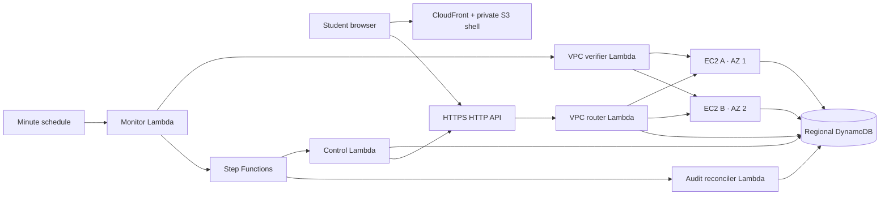

# Continuum demonstration runbook

## Start the local rehearsal

From the repository root:

```sh
cd web && bun install --frozen-lockfile && cd ..
make demo-local
```

Open `http://localhost:3000`. The API/router is on `127.0.0.1:8080`; the separate A/B HTTP servers are on `8001` and `8002`, inside one Go process with shared memory. The local stop action closes the selected server and its connections, so real HTTP requests fail and the router must recover. Restarting the entire launcher loses local data; sign out and sign in again afterwards. The cloud deployment uses persistent DynamoDB and separate EC2 instances.

If another app occupies port 3000, use `DEMO_WEB_PORT=3001 make demo-local`. The launcher refuses to silently pick another port. The local launcher raises the load threshold because both backends share the laptop with unrelated apps and compilers; application/database fault checks remain active. EC2 keeps the normal host-load health check.

The rehearsal launcher disables the developer-tools overlay and Vite console forwarding, keeping the faculty view focused and avoiding repeated forwarding of the same development error.

The first launch creates `.demo/local.env`, mode `0600`, containing the bootstrap faculty login and administrator control token. Read it privately and enter the control token in `/ops`; do not project the credentials file. Use separate browser profiles for faculty and student sessions. Register a synthetic student, select **Cloud Architecture CAT**, answer questions, and open the cockpit in the faculty session.

Fresh demo exams give each student a server-enforced **15-minute** attempt and one attempt limit. The teacher can configure duration and scheduled opening/closing in Assessments. Existing faculty-edited windows are preserved across restarts. Use a new synthetic student for each full rehearsal.

The admin token is separate from a student login. Fault/status endpoints require it. No secret is compiled into the static frontend.

## Verify the implementation

```sh
go test -race ./...
go vet ./...
cd web && bun run typecheck && bun run lint && bun run test && bun run build && cd ..
bash scripts/build_demo.sh
terraform -chdir=infra/demo init -backend=false
terraform -chdir=infra/demo validate
```

The real-HTTP integration test exercises response loss, A→B recovery, replay after an exam closes, request-ID payload conflicts, one audit summary, reconciliation replay, and monotonic failback. Unit tests separately verify DynamoDB transaction fencing and orchestration decisions. These tests are not substitutes for recording a cloud recovery run.

## AWS architecture and deployment

All regional resources are in `ap-southeast-2` (Sydney). Confirm the selected Region in **AWS Settings → View all projects → Overview → Additional Info → Region** if the project configuration changes. Keep the **Free** plan; this stack does not require an upgrade or advanced features.



The applications accept port `8000` only from the router/verifier security group. There is no inbound SSH. EC2 outbound access uses automatic public IPv4 addresses for bootstrap and Systems Manager; the application is still reached privately. Lambda uses private subnets and free S3/DynamoDB gateway endpoints, with no NAT gateway. Public smoke tests and AWS control API calls run outside that VPC.

The cloud router uses an API Gateway HTTP API and supports ordinary HTTP requests. The local router also proxies `/ws/board` WebSocket upgrades, but the cloud demo does not expose that board socket; the exam and control-plane rehearsal use HTTP routes only.

The current project Lambda quota is **10 total concurrent executions**. The stack therefore uses no reserved concurrency and bounds public traffic to a small faculty demo (HTTP API rate 3 requests/second, burst 6). Client submissions preserve their request IDs during bounded throttling retries. This is not a high-load deployment.

Use the existing short-term project login. Then:

```sh
make demo-deploy
make demo-resume
```

`demo-deploy` verifies that the plan is Free, runs checks, builds the Linux artifacts, reviews a Terraform plan, creates the stack, rebuilds the frontend with its actual HTTPS API origin, and uploads the static build through Terraform. It creates two small instances, a regional on-demand table, a workflow, small Lambda functions, and a static CDN origin. Monitoring initially starts disabled. `demo-resume` starts the instances and enables it.

Private output values are written to `.demo/aws-output.json`; URLs are also Terraform outputs. This file and local Terraform state contain secrets and must stay outside Git and presentation screenshots. Use a dedicated, private workspace for state. No purchased domain is needed.

Allow both application instances to finish their initial bootstrap. In the cockpit, verify both deep-health checks before injecting a fault. After an EC2 stop during an enabled rehearsal, **Reset** starts the instance; wait for health to return and repeat Reset if it reports that an instance is still starting. Failback requires verified health and advances the epoch.

The currently deployed control Lambda predates the runtime-gated Reset guard now in the repository. Until the next control-Lambda deployment, do not use cockpit **Reset** while the AWS stack is paused; resume through `make demo-resume`. After deployment, Reset is enabled only when Terraform has both `instances_running` and `monitor_enabled` set to true. The current AWS deployment remains paused and has not been updated by this documentation change.

## Cost controls

Check **AWS Settings → Billing** before a rehearsal. The user initially reported $100; the latest AWS plan API reported $140 remaining on 10 October 2026. The Free plan expires on **7 March 2027**. Credits, eligibility, and current balance must be checked again before a later deployment. Do not switch to Paid to make a blocked service work.

The planning prices verified for Sydney were $0.0132/hour per `t3.micro`, $0.005/hour per public IPv4 address, and $0.096/GB-month for `gp3`. The two running instances and their IPs therefore use about **$0.0364/hour** before disks, requests, logs, storage, and tax. Twenty GB of retained disks add about **$1.92 per full month**; stopping instances does not delete disks. These are planning estimates, not a guarantee of free service. See [EC2 pricing](https://aws.amazon.com/ec2/pricing/on-demand/), [public IPv4 pricing](https://aws.amazon.com/vpc/pricing/), and [EBS pricing](https://aws.amazon.com/ebs/pricing/).

Keep development local. Allocate at most $20 of project credits to the cloud prototype, preserve a $25 reserve, and stop new experiments if the remaining balance falls below $50. Create budget alerts in the AWS Billing and Cost Management console; alerts do not stop spending. The Free plan prevents a paid overrun, but exhausted credits or expiry can make the project unavailable before evaluation.

After every cloud rehearsal:

```sh
make demo-pause
```

This stops both EC2 instances and disables the monitor schedule. Existing Lambda executions or workflows may finish. Retained EBS/S3/DynamoDB storage can still consume credits. After the faculty evaluation, export any needed synthetic evidence and use `make demo-destroy`; Terraform asks for confirmation because that removes the table and buckets as well as compute.

Pause/resume persist those two choices in the ignored `infra/demo/runtime.auto.tfvars.json`. Later web updates therefore preserve the paused state instead of silently restarting compute through variable defaults.

## Automated cloud rehearsal

With both instances healthy, A active, and monitoring enabled:

```sh
python3 scripts/rehearse_cloud.py
```

The script reads the private deployment outputs, registers a synthetic student, commits a submission while dropping its response, stops the actual A instance, waits for scheduled recovery to B, and replays the original request. It checks an unchanged commit timestamp and rejects altered answers under the original ID. It then starts a separate asynchronous reconciliation workflow and waits for a zero-work completion event. It writes answer/receipt evidence and control events to `docs/evidence/cloud-rehearsal.json`, without login tokens or passwords.

Cloud manual reconciliation is asynchronous so a larger backlog cannot keep the public HTTP request open beyond its API timeout. The workflow's overall execution timeout stays inside the incident lease. Its history contains each reconciliation page and final summary.

Linux bundles use fixed archive metadata and sorted inputs. Rebuilding unchanged source preserves hashes. A changed application bundle updates EC2 bootstrap data and replaces both demo instances on the next full Terraform apply; inspect that plan and avoid doing this during an assessment. DynamoDB data and existing assessment windows remain persistent.

## Evidence to preserve

Record the demo mode, scenario, fault timestamp, confirmed decision timestamp, old/new backend and epoch, successful public-route timestamp, submission request ID and commit time, canonical submission count, audit count, and suppressed decision reason. Keep screenshots or a recording of the student view and cockpit together. Report observed recovery durations instead of a promised SLA.

The recovery cockpit's local metrics are cumulative since the demo process started; its event list is capped at 100 entries. AWS metrics are derived from the recent 50 stored control-plane events, not lifetime counters. Its recovery duration runs from the start of the monitor check cycle to successful public smoke, including the first probe; the external fault-to-observed-recovery duration also includes scheduling delay, polling, and reconciliation. A green public smoke verifies the routed deep-health endpoint. Durable submission correctness is demonstrated separately by the request-ID receipt and transaction tests.

The design does not claim recovery from DynamoDB failure or a complete Sydney Region outage. Both backends rely on the same regional data service. Recovery of an unacknowledged offline answer is constrained by the original exam deadline.

## IAM policy provenance

Runtime identity policies start with the deterministic IAM Policy Autopilot baseline. The exact generation command used was:

```sh
DISABLE_IAM_POLICY_AUTOPILOT_TELEMETRY=true uvx iam-policy-autopilot@latest generate-policies /Users/ayush/Developer/slate/internal/store/store.go /Users/ayush/Developer/slate/internal/continuum/cloud.go /Users/ayush/Developer/slate/internal/continuum/dynamodb.go /Users/ayush/Developer/slate/internal/continuum/events.go /Users/ayush/Developer/slate/cmd/demo-reconciler/main.go --region ap-southeast-2 --account 927161114608 --tf-dir /Users/ayush/Developer/slate/infra/demo --service-hints dynamodb lambda sfn ec2 --pretty > infra/demo/policies/autopilot-baseline.json
python3 scripts/generate_demo_policies.py
```

The reviewed templates bind those actions to the actual Terraform table, workflow, functions, and A/B instances. They omit replication actions, unused execution-description actions, wildcard KMS decryption, and license/resource-group permissions not used by this single-Region AL2023 prototype. The app role cannot write the control or audit partitions; its transactional fence condition can read the control item. The monitor has no fault-control token. AWS managed policies supply logging, VPC network-interface operations, and Systems Manager connectivity.

AL2023 includes [AWS CLI v2](https://docs.aws.amazon.com/linux/al2023/ug/awscli2.html). Bootstrap uses the distribution's `awscli-2` package, a private S3 bundle, and a SecureString runtime parameter. Temporary credentials are supplied by instance and Lambda service roles.
